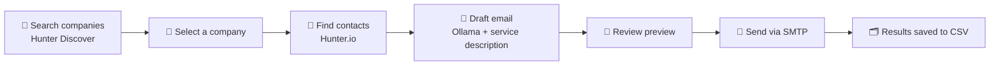

<div align="center">

# 📬 AI-Powered Cold Email Automation Platform

**Discover companies, find contacts, draft personalized emails with a local LLM, review them, and send, all from one dashboard.**


</div>

---

## ✨ Features

| | Feature | Description |
|---|---|---|
| 🔎 | **Company discovery** | Find up to 100 company domains through Hunter Discover by location and/or open job title |
| 📧 | **Contact lookup** | Asynchronous Hunter.io email discovery and verification for each selected company |
| 🤖 | **Local AI drafting** | Personalized subject, body, and personalization reason generated by an Ollama model running on your own machine |
| 👀 | **Preview before sending** | Review every draft in the dashboard. Previewing never sends email |
| 🚀 | **SMTP sending** | Send reviewed drafts through your own SMTP account, with a confirmation prompt per email |
| 💬 | **Built-in chat** | "Talk with Ollama" panel with streaming replies and bounded history |
| 📦 | **Batch processing** | Create, pause, resume, and export batches as CSV |
| 🗂️ | **Simple persistence** | Results are stored in a CSV file, with no database to manage |
| 🪵 | **Request-traceable logs** | Rotating log files with a request ID on every failed request |
| 🐳 | **Docker Compose** | One command to run the API and dashboard |

---

## 🧭 How It Works



1. **Search** companies by location and/or the job title they are hiring for.
2. **Select** a company and choose how many addresses to look up.
3. **Preview** the generated draft (subject, body, personalization reason).
4. **Send** it from the dashboard after you review it.

---

## 🛠️ Tech Stack

- **Backend:** FastAPI (Python)
- **LLM:** Ollama (default model: `qwen2.5:3b`), running on the host machine
- **Lead data:** Hunter.io API
- **Email delivery:** SMTP
- **Storage:** Date-stamped CSV files (`data/batches_YYYY-MM-DD.csv`)
- **Frontend:** Lightweight dashboard served by the API
- **Deployment:** Docker Compose

---

## 🚀 Quick Start

### Prerequisites

- [Docker](https://www.docker.com/) with Docker Compose
- [Ollama for Windows](https://ollama.com/download)
- A [Hunter.io](https://hunter.io/) API key
- An SMTP account (host, port, username, password)

### 1. Install and configure Ollama

Set `OLLAMA_HOST=0.0.0.0:11434` in your Windows Environment Variables, then fully exit Ollama. To start its server from PowerShell:

```powershell
$env:OLLAMA_HOST = "0.0.0.0:11434"
ollama serve
```

> Keep that PowerShell window open while using the app. This lets the API container reach the host at `host.docker.internal:11434`. Ollama is **not** run as a Docker service in this setup.

### 2. Secure the Ollama port

Ollama's API has **no authentication**. In an elevated PowerShell, allow only the app's Docker subnet through Windows Firewall:

```powershell
New-NetFirewallRule -DisplayName "Ollama for Cold Email API" -Direction Inbound -Action Allow -Protocol TCP -LocalPort 11434 -RemoteAddress 172.18.0.0/16 -Profile Private
```

The command uses the subnet from this Compose setup. Verify yours with:

```powershell
docker network inspect coldemailsautomation_default
```

> ⚠️ Keep Windows Firewall enabled and never expose port `11434` to the public internet.

### 3. Pull the model

```powershell
ollama pull qwen2.5:3b
```

### 4. Configure environment variables

Copy `.env.example` to `.env` and fill in your values:

| Variable | Purpose |
|---|---|
| `OLLAMA_BASE_URL` | Ollama address (default: `http://host.docker.internal:11434`) |
| `OLLAMA_MODEL` | Model used for drafts and chat (default: `qwen2.5:3b`) |
| `OLLAMA_CHAT_MAX_TOKENS` | Chat response length cap (default: `96`) |
| `HUNTER_API_KEY` | Your Hunter.io API key |
| SMTP credentials | Host, port, username, and password for your mail account |
| `SMTP_FROM_EMAIL` | Sender address |
| `MAIL_FROM_NAME` | Sender name passed to the model |
| `MAIL_FROM_COMPANY` | Sender company passed to the model |
| `MAIL_FROM_TITLE` | Sender title passed to the model |
| `LOG_LEVEL` | Logging level (set `DEBUG` for detailed logs) |

> 🔐 Never commit your `.env` file. Make sure it is listed in `.gitignore`.

### 5. Describe your service

Edit `instructions/service_description.txt` with **factual** details about your service, audience, benefits, sender name, and desired call to action. The API reads this file for every draft.

- Docker mounts the folder read-only, so edits take effect **without rebuilding**.
- Keep using the `.txt` instruction files in `instructions/`; no Python instruction module is required.
- Only include claims you can support. The generator is meant to use only what is written here.
- Configured GitHub, LinkedIn, and portfolio URLs are added to the email signature automatically if the model omits them.

### 6. Start the app

```bash
docker compose up -d --build
```

Open the dashboard at **http://localhost:8000/**.

---

## 🖥️ Using the Dashboard

1. Enter a **location** and/or an **open job title** and search (up to 100 company domains).
2. Select a company and choose how many email addresses to look up.
3. Click **Preview** to generate a draft. Nothing is sent at this stage.
4. Review the subject, body, and personalization reason.
5. Click **Send** on the drafts you approve. You will be asked to confirm each one.
6. Use **Talk with Ollama** for quick chat with the configured model. History stays in your browser and clears with **New chat**. Each request is limited to 20 messages and 12,000 characters.

---

## 📡 API Reference

| Method | Endpoint | Description |
|---|---|---|
| `POST` | `/api/chat` | Chat with the configured Ollama model (bounded history, streamed replies) |
| `GET` | `/api/companies/discover?location=Canada&job_title=Marketing%20Director&limit=100` | Find up to 100 company domains via Hunter Discover. At least one of `location` or `job_title` is required. `job_title` is treated as an open role the company is hiring for |
| `GET` | `/api/emails/preview?domain=example.com&email_count=1` | Call Hunter and Ollama and return company/recipient details plus a generated subject, body, and personalization reason. **Does not save a batch or send email** |
| `POST` | `/api/emails/send` | Send a reviewed preview draft through the configured SMTP account |
| `POST` | `/batches` | Create a batch from a `domain` and `email_count` (default `1`). ⚠️ **Sends automatically** |
| `GET` | `/batches` | List saved batch summaries |
| `GET` | `/batches/{batch_id}` | Fetch batch status, recipient and company details, drafts, and send results |
| `POST` | `/batches/{batch_id}/pause` | Pause processing |
| `POST` | `/batches/{batch_id}/resume` | Resume processing |
| `POST` | `/batches/{batch_id}/approve/{item_id}` | Legacy manual approval endpoint |
| `POST` | `/batches/{batch_id}/send-approved` | Legacy manual send endpoint |
| `GET` | `/batches/{batch_id}/export/csv` | Export batch results as CSV |

> ⚠️ **`POST /batches` sends emails automatically.** Verify your Hunter, Ollama, and SMTP settings and test with a mailbox you control before using real recipient addresses.

---

## 💾 Data & Logs

- **Results:** `data/batches_YYYY-MM-DD.csv` stores Hunter results, batch status, generated drafts, and delivery results, using one file per day. New records for the same day are added to that day's file. Duplicate email checks include all dated files and any existing legacy `data/batches.csv`, so previously saved recipients are not processed or sent again. The host `data` folder is mounted into Docker, so files survive container recreation. The earlier SQLite database and saved-contact workflow are no longer used.
- **App logs:** `logs/app.log` (rotated at 5 MB, with 3 backups). Failed requests include a request ID in the log and an `X-Request-ID` response header.
- **Debug logging:** Set `LOG_LEVEL=DEBUG` in `.env` and recreate the API container to log detailed Hunter results, verification responses, Ollama drafts, and SMTP activity.
  > ⚠️ Debug logs can contain recipient details and generated email content. Protect `logs/app.log` and turn debug logging off when you are finished.
- **Container logs:**
  ```bash
  docker compose logs -f
  ```

---

## 🔄 Changing the Model

```powershell
ollama pull <model>
```

Update `OLLAMA_MODEL` in `.env`, then recreate the API:

```bash
docker compose up -d --no-deps --force-recreate api
```

Very small models may produce lower-quality email drafts.

---

## 💻 Local Development

```powershell
python -m venv .venv
.venv\Scripts\python.exe -m pip install -r requirements.txt
$env:OLLAMA_BASE_URL = "http://localhost:11434"
.venv\Scripts\python.exe -m uvicorn app.main:app --reload --host 0.0.0.0 --port 8000
```

---

## 🩺 Troubleshooting

<details>
<summary><b>❌ <code>ollama pull</code> fails with <code>x509: certificate signed by unknown authority</code></b></summary>

The Windows Ollama app cannot verify the certificate chain presented by your network. This often happens when a company proxy or antivirus performs HTTPS inspection.

- **Do not disable TLS verification.**
- Ask your IT or network administrator to install the trusted root certificate in the Windows certificate store, then restart Ollama and retry.
- Never install a certificate from an untrusted source.
- If your network does not use a TLS-inspecting proxy, make sure Windows is current and its date, time, and trusted root certificates are up to date.
- Ollama keeps any model layers it already downloaded, so a retry resumes where it left off.

</details>

<details>
<summary><b>❌ Pydantic <code>ForwardRef._evaluate()</code> error in the API container</b></summary>

Rebuild with the pinned compatible dependencies:

```bash
docker compose build --no-cache api
docker compose up -d --force-recreate api
```

</details>

<details>
<summary><b>❌ The API container cannot reach Ollama</b></summary>

- Confirm `ollama serve` is running with `OLLAMA_HOST=0.0.0.0:11434`.
- Confirm `OLLAMA_BASE_URL` is `http://host.docker.internal:11434`.
- Check that the firewall rule matches your Docker subnet (`docker network inspect coldemailsautomation_default`).

</details>

---

## ⚖️ Responsible Use

This tool can send real emails to real people. Use it responsibly:

- Send only relevant, honest, business-to-business outreach.
- Follow the laws that apply to your recipients, such as **CAN-SPAM** (US), **GDPR** (EU/UK), and **CASL** (Canada). This typically includes a truthful sender identity and a clear way to opt out.
- Respect unsubscribe and "do not contact" requests.
- Start with small volumes and a mailbox you control.
- Review every draft. AI-generated text can contain mistakes.
- Keep API keys and SMTP credentials out of version control.

---

## 🔒 Security Notes

- Never commit `.env`, API keys, or SMTP passwords.
- Ollama has no built-in authentication. Restrict access with a firewall as described above.
- Protect `data/batches_*.csv` and `logs/app.log`, since they can contain recipient details and email content.

---

<div align="center">

**Built with FastAPI, Ollama, and Hunter.io**

⭐ If you find this project useful, consider giving it a star!

</div>